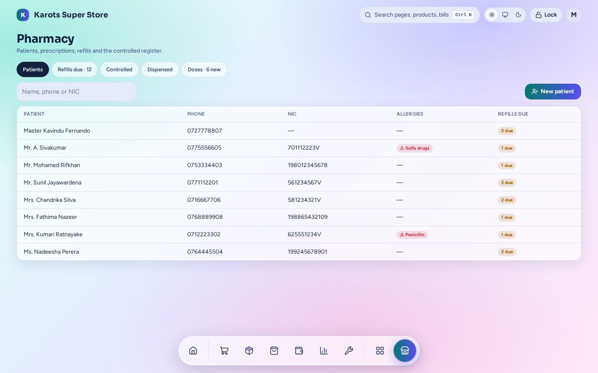

Patients, prescriptions and the controlled-drug register for a pharmacy. It comes with [Product Plus](/plugins/productplus/) and [Alternatives](/plugins/alternatives/).

- **Patients** are customers with allergies and a profile (NIC, phone).
- **Prescriptions** understand dose shorthand like `1-0-1` and work out how much to give.
- A **💊 Patient** panel at the till adds a script's medicines to the cart. The dispense (who was given what, for the controlled register) is saved with the sale itself, so it can't go missing; a receipt sold without a patient can be recorded later from the register. A dose label can print.
- **Refills due:** a call list of patients whose medicine is about to run out.
- **Controlled-drug register:** read straight from stock movements, so it can't drift from the real stock. A controlled drug can't be [frozen](/guides/stock/#freezing-stock-while-a-shop-starts): count it in full on day one.
- With [AI Assistant](/plugins/aicatalog/), the prescription and controlled marks and usual doses can be suggested in bulk, for the pharmacist to check. A chatbot's answer is only a suggestion: it can miss a mark or be wrong about a dose.
- Medicines use core [packs](/guides/stock/#products) (a card of 10 sold whole or loose) and [batches](/guides/stock/#batches-and-expiry).

The admin page is under **Apps → Pharmacy**.